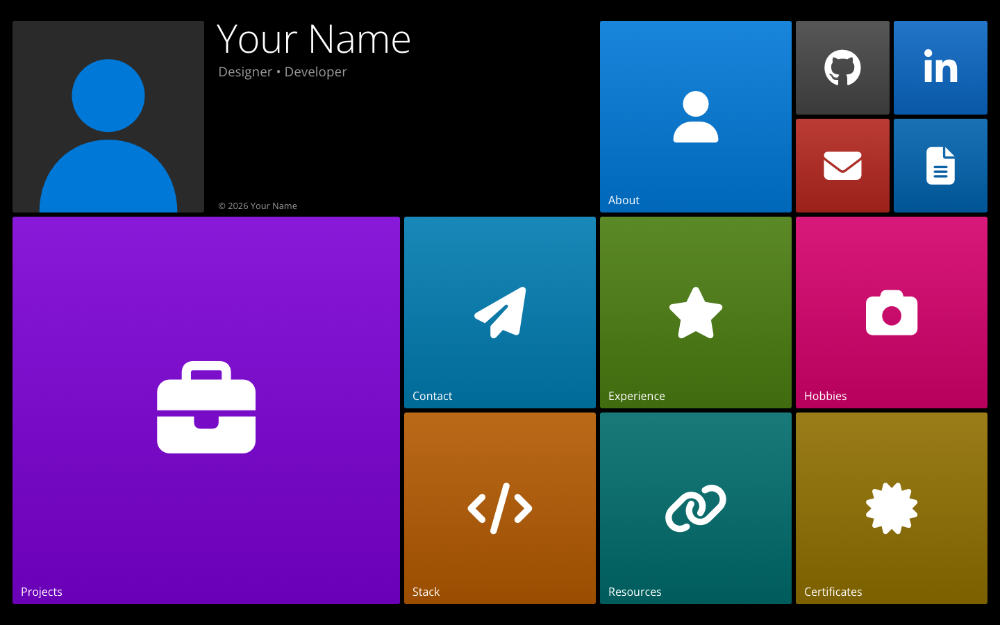
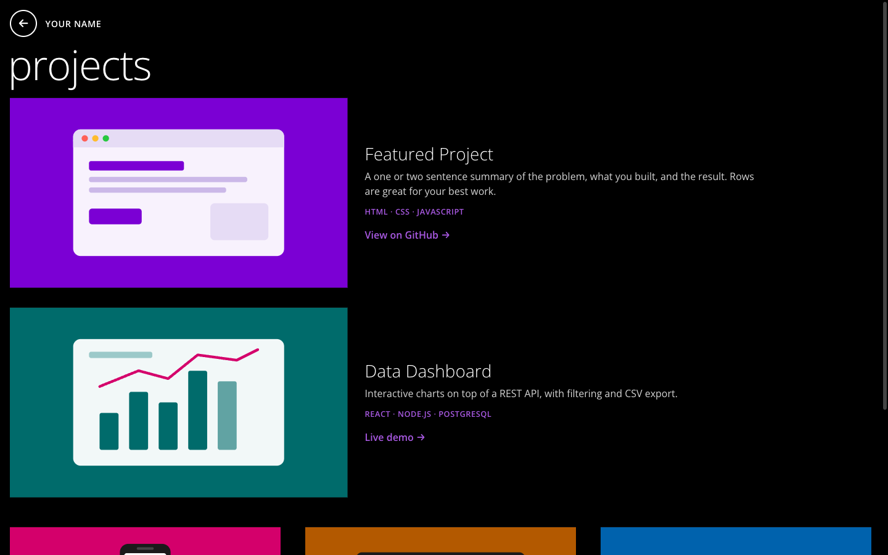

# Tilefolio

A single-screen portfolio template styled after the Windows Phone start screen. Each
tile opens a full-screen page with your bio, projects, skills, experience and more,
all driven by **one content file**.

No frameworks, no build step, no dependencies to install. Plain HTML, CSS and JavaScript
that you can host anywhere (GitHub Pages, Netlify, Vercel, any static host).

**[Live demo](https://amirgholizad.github.io/tilefolio/)** · [Use this template](https://github.com/amirgholizad/tilefolio/generate) · [MIT licensed](LICENSE)





## Features

- **One file to edit.** Your name, links, tiles and overlay content all live in [`content.js`](content.js).
- **Zero build.** Open `index.html` and it works. Deploy by uploading the folder.
- **Deep links.** Every overlay has its own URL (`yoursite.com/#projects`) that you can share, bookmark or open in a new tab. The browser's Back button closes overlays.
- **Windows Phone feel.** Flat tiles in four sizes that pack into a mosaic, live tiles that flip to show a subtitle, the press-to-tilt effect, turnstile animations, and pages with big light lowercase titles. No drop shadows or glows.
- **Accessible.** Real links and dialog semantics, keyboard support (Tab, Enter, Esc), focus management, `prefers-reduced-motion` support (turns off live tiles, tilt and animations), and default colors that meet WCAG contrast for white text.
- **Fills the screen.** Your profile sits in the tile grid itself, and on desktop and tablets the column count (6 to 12) and tile size are picked to fill the screen with little empty space. On phones the tiles fill the width and the page scrolls, like a phone's start screen.
- **Flexible.** Any number of tiles, any tile colors, and four content block types: text, cards, badges and projects (with images or YouTube embeds).

## Quick start

1. Click **Use this template** on GitHub (or fork / clone the repo):

   ```sh
   git clone https://github.com/amirgholizad/tilefolio.git my-portfolio
   cd my-portfolio
   ```

2. Preview it locally. Opening `index.html` directly works, but a local server is
   recommended (YouTube embeds won't play from `file://`):

   ```sh
   python3 -m http.server 8000
   # then visit http://localhost:8000
   ```

3. Edit `content.js`, update the `<head>` of `index.html`, and swap the images in
   `assets/` (see [Customizing](#customizing)).

## Customizing

### 1. Content: `content.js`

Everything visible on the page comes from `window.TILEFOLIO` in `content.js`:

```js
window.TILEFOLIO = {
  profile: {
    name: "Your Name",
    tagline: "Designer • Developer",
    avatar: "assets/images/avatar.svg",
    // Optional round icon buttons in the profile block. The default content shows
    // social links as small tiles instead.
    socials: [
      { label: "GitHub", icon: "fa-brands fa-github", url: "https://github.com/your-username" },
    ],
  },
  footer: "© {year} Your Name", // shown in the profile block; {year} becomes the current year
  tiles: [
    /* ... */
  ],
};
```

### 2. Tiles

A tile either **opens an overlay** (a full-screen page) or **links somewhere**. Web
links and files open in a new tab; `mailto:` and `tel:` links open in place.

```js
// Overlay tile: opens at yoursite.com/#about
{
  id: "about",                 // unique; used in the URL
  title: "About",
  subtitle: "Learn more about me", // shown when the live tile flips, or on hover
  icon: "fa-solid fa-user",    // any free Font Awesome 6 icon
  color: "#0078d7",            // tile background and the page's accent color
  size: "medium",              // optional: "small", "medium" (default), "wide", "large"
  overlay: {
    title: "About Me",         // optional, defaults to the tile title
    blocks: [ /* see below */ ],
  },
},

// Small link tile (icon only; the title shows as a tooltip)
{ id: "github", title: "GitHub", icon: "fa-brands fa-github", color: "#444444", size: "small", href: "https://github.com/your-username" },
```

**Tile sizes** are measured in grid cells:

| Size     | Cells | Shows                 |
| -------- | ----- | --------------------- |
| `small`  | 1×1   | Icon only             |
| `medium` | 2×2   | Icon and title        |
| `wide`   | 4×2   | Icon and title        |
| `large`  | 4×4   | Icon and title        |

Your profile (photo, name, tagline and footer text) is a 6×2 block at the start of the
grid. Tiles follow in order and are packed densely, so four small tiles fill the space of
one medium tile. On desktop and tablets the script tries 6, 8, 10 and 12 columns and
keeps whichever gives the biggest tiles while everything fits on screen; phones always
use 6. The default content adds up to 60 cells, which fills a 10×6 grid on desktop and
6×10 on phones with no gaps.

Find icons at [fontawesome.com/search](https://fontawesome.com/search?o=r&m=free). Pick a
tile color dark enough for white text (aim for a contrast ratio of 4.5:1 or more).

### 3. Overlay blocks

An overlay is a list of blocks, rendered top to bottom. Mix them however you like.

| Type       | Use it for                       | Fields                                                                                                                         |
| ---------- | -------------------------------- | ------------------------------------------------------------------------------------------------------------------------------ |
| `text`     | Bio, intro, any prose            | `paragraphs: []`, optional `image: { src, alt, caption }`                                                                       |
| `cards`    | Contact, experience, hobbies, certificates | `columns` (1–3), `items: [{ icon, title, text, link: { label, url } }]`                                               |
| `badges`   | Skills / tech stack              | `groups: [{ title, items: [] }]`                                                                                                |
| `projects` | Portfolio pieces                 | `layout: "rows"` or `"grid"`, `items: [{ title, description, tech: [], image, video, link: { label, url } }]`                   |

Everything except `type` and `title` is optional. Use `\n` inside card `text` or an
image `caption` for a line break.

**Project videos:** for a YouTube demo, use the embed URL instead of an image:

```js
{ title: "My App", video: "https://www.youtube.com/embed/VIDEO_ID", link: { label: "Code →", url: "..." } }
```

Videos stop playing when the overlay closes.

### 4. SEO and social previews: `index.html`

Search engines and link previews (Slack, LinkedIn, X, ...) don't run JavaScript, so
the `<title>`, description, Open Graph tags and JSON-LD stay in the `<head>` of
`index.html`. Replace every `Your Name` and `example.com` value there.

The link preview image is `assets/images/social-preview.png`. Replace it with a
screenshot of your own site (1280×640 PNG or JPG; most previews don't support SVG).

### 5. Images and files

| File                          | Replace with                                       |
| ----------------------------- | -------------------------------------------------- |
| `assets/images/avatar.svg`    | Your photo (square works best)                     |
| `assets/images/about.svg`     | A photo for the About overlay                      |
| `assets/images/project-*.svg` | Project screenshots (16:9 works best)              |
| `assets/files/resume.pdf`     | Your resume                                        |
| `assets/images/social-preview.png` | A 1280×640 screenshot for link previews       |
| `assets/favicon.svg`          | Your favicon                                       |

Any format works (`.jpg`, `.png`, `.webp`, `.svg`). Just update the paths in `content.js`.

### 6. Theme

Shared colors, tile gap, corner radius and font are CSS custom properties at the top of
[`css/style.css`](css/style.css). Set `--tile-radius: 0` for perfectly square tiles. The
font is Segoe UI where it's installed (Windows), falling back to
[Open Sans](https://fonts.google.com/specimen/Open+Sans), which is loaded in `index.html`.

## Deploying

**GitHub Pages:** push the repo, then go to *Settings → Pages → Deploy from a branch* and
pick `main` / `/ (root)`. A minute later your site is live at
`https://<username>.github.io/<repo>/` (or `https://<username>.github.io/` if the repo
is named `<username>.github.io`). All paths are relative, so it works from either. The
empty `.nojekyll` file tells GitHub Pages to serve the files as they are, without Jekyll.
To use a custom domain, add a `CNAME` file containing your domain.

**Anywhere else:** it's a static folder. Drag it into Netlify Drop, run `vercel`, or
upload it to any web server.

## Project structure

```
.
├── index.html          # Page shell + SEO tags
├── content.js          # All your content (edit this)
├── js/tilefolio.js     # Renderer: tiles, live tiles, overlays, routing (no need to edit)
├── css/style.css       # Styles and theme variables
├── assets/             # Favicon, images, resume
└── docs/               # README screenshots
```

## Browser support

Current versions of Chrome, Edge, Firefox and Safari.

## Contributing

Bug reports and pull requests are welcome. Please open an issue first for larger
changes, so we can agree on the approach. Tilefolio stays dependency-free and
build-free: plain HTML, CSS and JavaScript that works when you open `index.html`.

Built something with Tilefolio? Open an issue with a link; I'd love to see it.

## Credits

- Inspired by the tile-based home screen of Windows Phone. Windows Phone is a trademark
  of Microsoft Corporation; Tilefolio is an independent project and is not affiliated
  with or endorsed by Microsoft.
- Icons by [Font Awesome Free](https://fontawesome.com/license/free) (CC BY 4.0 / SIL OFL / MIT).
- Typeface [Open Sans](https://fonts.google.com/specimen/Open+Sans) (SIL Open Font License).

## License

[MIT](LICENSE). Use it, change it, ship it.
